  

# 🏢 Awesome Enterprise Social Collaboration

  
  
  
  
  
  
  

---

## 🧭 Executive Summary & SEO Overview

**Awesome Enterprise Social Collaboration** is a meticulously curated index and market intelligence repository tracking enterprise communication ecosystems, internal social networks (ESNs), digital workplaces, and self-hosted collaboration suites.

Whether you are an Enterprise Architect, IT Director, Chief Information Officer (CIO), HR leader, or Open-Source Enthusiast, this guide compares high-scale commercial SaaS solutions with sovereign, self-hosted, and air-gapped open-source infrastructure.

### 🎯 Key Focus Categories
- **Internal Social Networks & ESNs**: Community hubs, company newsfeeds, status updates, and employee knowledge sharing (e.g., Viva Engage, Workvivo, HumHub).
- **Channel-Based Team Messaging**: Real-time channels, threads, huddles, and chat workflows (e.g., Slack, Microsoft Teams, Mattermost, Rocket.Chat, Zulip).
- **Modern Employee Experience & Intranets (EXP)**: Mobile-first frontline communications, recognition systems, and unified digital workspaces (e.g., Blink, Staffbase, Simpplr).
- **Data Sovereignty & Self-Hosted Collaboration**: Self-contained, on-premise, GDPR/HIPAA-compliant platforms guaranteeing zero vendor lock-in.

---

## 📑 Table of Contents

- [🏢 Awesome Enterprise Social Collaboration](#-awesome-enterprise-social-collaboration)
  - [🧭 Executive Summary \& SEO Overview](#-executive-summary--seo-overview)
  - [📑 Table of Contents](#-table-of-contents)
  - [📊 Sector Overview \& Market Dynamics](#-sector-overview--market-dynamics)
  - [☁️ Enterprise SaaS Platforms](#️-enterprise-saas-platforms)
  - [🔓 Open-Source GitHub Projects](#-open-source-github-projects)
    - [Architecture Blueprint: Hybrid Sovereign Stack](#architecture-blueprint-hybrid-sovereign-stack)
  - [🤝 How to Contribute](#-how-to-contribute)
  - [📈 Star History](#-star-history)
  - [💖 Support \& Community](#-support--community)
  - [⚖️ Disclaimer](#️-disclaimer)

---

## 📊 Sector Overview & Market Dynamics

- **Estimated Market Size**: The global Enterprise Social Collaboration and Digital Workplace software market is currently estimated at **$45–$55 billion in 2026**, projected to exceed **$85 billion by 2030** expanding at a compound annual growth rate (CAGR) of **~14.2%**.
- **Market Structure & Concentration**: The sector exhibits a distinct **barbell dynamic: highly concentrated at the general productivity suite layer, but moderately fragmented in specialized employee experience and sovereign intranet tiers**. Mega-cap ecosystems—namely Microsoft 365 (Teams/Viva Engage) and Salesforce (Slack/Chatter)—operate as dominant, winner-takes-most market anchors for daily workspace messaging. Conversely, specialized frontline worker engagement (e.g., Blink, Connecteam), AI-powered intranets (e.g., Simpplr, Staffbase, Workvivo), and privacy-first self-hosted open-source software (e.g., Mattermost, HumHub, Nextcloud) command rapidly growing niches driven by departmental specialization, strict compliance (GDPR, HIPAA), and avoidance of single-vendor lock-in (exemplified by the 2025/2026 sunset of Workplace from Meta).

---

## ☁️ Enterprise SaaS Platforms

The table below lists the leading enterprise commercial platforms, sorted in descending order by **Company Valuation / Market Capitalization / Annual Revenue**.

| 🏷️ Platform | 🏢 Company Size (Valuation / Revenue) | 💳 Starting Tier Pricing | 🎁 Free Tier Limits | 📝 Core Capabilities & Enterprise Focus |
| :--- | :--- | :--- | :--- | :--- |
| **[Microsoft Teams](https://www.microsoft.com/en-us/microsoft-teams/group-chat-software) / [Viva Engage](https://www.microsoft.com/en-us/microsoft-viva/engage)** | **Market Cap: ~$3.1 Trillion** (Microsoft FY24 Revenue: $245.1B) | **$4.00 / user / month** (Teams Essentials, billed annually) or **$6.00 / user / month** (M365 Business Basic with full suite) | **Free forever plan**: Up to 100 participants per meeting, 60 minutes group meeting limit, 5 GB cloud storage/user, and unlimited 1:1 & group chat | Unified enterprise communication platform deeply integrated into Microsoft 365. Includes channels, video meetings, and Viva Engage (formerly Yammer) for corporate social networking and communities. |
| **[Workplace from Meta](https://www.workplace.com/)** | **Market Cap: ~$1.5 Trillion** (Meta FY24 Revenue: $164.8B) | **$4.00 / user / month** (Core plan prior to deprecation; migrated customers to Zoom's Workvivo) | **30-day free trial** with full enterprise features for up to 50 users (read-only through May 2026; data deleted June 1, 2026) | Corporate social network modeled on Facebook. Included Groups, News Feed, Knowledge Library, and Live video. Preferred migration partner designated as Workvivo by Zoom. |
| **[Slack](https://slack.com/)** | **Market Cap: ~$280 Billion** (Salesforce FY25 Revenue: ~$38B; acquired for $27.7B) | **$7.25 / user / month** (Pro plan, billed annually) or **$8.75 / user / month** (billed monthly) | **Free forever plan**: 90 days of message and file history, 10 third-party app integrations, 1:1 audio/video huddles, and 1 canvas per channel/DM | Channel-based messaging platform featuring huddles, interactive canvas documents, 2,600+ app integrations, cross-company Slack Connect, and native generative AI search. |
| **[Salesforce Chatter](https://www.salesforce.com/)** | **Market Cap: ~$280 Billion** (Salesforce FY25 Revenue: ~$38B) | **$15.00 / user / month** (Chatter Plus standalone) or included in Salesforce Starter Suite at **$25.00 / user / month** | **Free forever license ("Chatter Free")**: Up to 5,000 internal employee licenses per Salesforce org (profiles, feeds, and group discussions without CRM data access); **30-day free trial** for Starter Suite | CRM-embedded enterprise social network connecting discussions directly to CRM accounts, leads, opportunities, cases, and automated workflows. |
| **[Workvivo (Zoom)](https://www.workvivo.com/)** | **Market Cap: ~$20 Billion** (Zoom FY25 Revenue: ~$4.6B; acquired in 2023) | **$20,000 / year** baseline package (approx. **$3.50 – $4.00 / user / month** for 250–2,000 seat deployments) or packaged in Zoom Workplace | **30-day free pilot trial** (dedicated interactive sandbox environment for up to 250 enterprise employees with executive sponsorship) | Communication-centric employee experience and social intranet platform. Features activity feeds, peer recognition/shoutouts, mobile app, and live streaming; Meta's only preferred Workplace migration partner. |
| **[Staffbase](https://staffbase.com/)** | **Valuation: ~$1.1 Billion** (Unicorn status, raised $145M Series E; ~$100M+ ARR) | **$4.00 / user / month** (Starter Employee App package, typically min. $6,000/year annual contract) | **14-day free trial** (guided sandbox environment for up to 25 users with mobile employee app preview upon consultation) | Mobile-first employee intranet and internal communications platform featuring multi-channel email publishing, employee app, personalized newsfeeds, and engagement analytics. |
| **[Connecteam](https://connecteam.com/)** | **Valuation: ~$800 Million** (Raised $120M Series C led by Stripes & Insight Partners) | **$29.00 / month flat** for up to 30 users ($0.97 / user / month) + $0.50 / user / month for additional users (Basic plan, annual billing) | **Free forever plan**: 100% free forever for small teams up to 10 users with full employee chat, company updates feed, surveys, and knowledge base | All-in-one employee collaboration app built for frontline and deskless teams. Combines company social feeds, group chats, shift scheduling, training, and digital operational forms. |
| **[Simpplr](https://www.simpplr.com/)** | **Valuation: ~$550 Million** (Raised $110M+ Series D led by Norwest & Sapphire) | **$8.00 / user / month** (billed annually; standard starting commitment of 100 seats / ~$9,600/year) | **14-day free trial** (interactive demo sandbox environment with modern AI intranet features available upon verification) | AI-powered modern intranet and employee experience platform. Delivers automated content moderation, personalized feed discovery, federated search, and sentiment analytics. |
| **[Igloo Software](https://www.igloosoftware.com/)** | **Valuation: ~$100+ Million** (Acquired by Audax Private Equity for $100M+) | **$8.00 / user / month** (Digital Workplace Essentials, minimum annual contract commitment) | **14-day free trial** (cloud digital workplace sandbox with pre-configured intranet templates for up to 20 users upon request) | Digital workplace intranet solution providing collaborative spaces, enterprise wikis, microblogs, document collaboration, and Microsoft 365 / Google Workspace integrations. |
| **[Blink](https://www.joinblink.com/)** | **Valuation: ~$100 Million** (Raised $20M+ Series A led by Next47) | **$3.75 / user / month** (Core plan, billed annually) | **14-day free trial** with full access to news feeds, secure messaging, hub documents, and forms for up to 100 users | Mobile-first frontline employee experience hub requiring no corporate email address. Features real-time chat, company news feed, digital surveys, and shift coordination. |
| **[Jostle](https://www.jostle.me/)** | **Valuation: ~$50 Million** (Est. ~$15M ARR; bootstrapped & growth funded) | **$4.00 / user / month** (Bronze tier, billed annually; min. 25 users) | **30-day free trial** (unlimited access to News feed, People directory, Discussions, and Library for up to 50 users) | People-centric employee intranet designed to improve company alignment, employee recognition, organizational directory mapping, and internal news broadcasting. |

---

## 🔓 Open-Source GitHub Projects

The following self-hosted and open-source collaboration platforms are sorted in descending order by **GitHub Stars_Count**. Each repository includes a real-time Stars_Badge linking directly to its stargazers page.

| 📦 Project & Repo Link | ⭐ Stargazers Badge | 📜 License | 🛠️ Tech Stack | 💡 Focus & Primary Enterprise Use Case |
| :--- | :--- | :--- | :--- | :--- |
| **[Discourse](https://github.com/discourse/discourse)** |  | `GPL-2.0` | Ruby on Rails, Ember.js, PostgreSQL | Modern discussion platform for enterprise community building, knowledge sharing, and structured asynchronous discussions. |
| **[Rocket.Chat](https://github.com/RocketChat/Rocket.Chat)** |  | `MIT` | TypeScript, Node.js, MongoDB | Real-time omnichannel team chat platform with audio/video conferencing, bot framework, Matrix federation, and SOC2/HIPAA compliance. |
| **[Outline](https://github.com/outline/outline)** |  | `BSL-1.1` | TypeScript, React, Node.js, PostgreSQL | Fast, collaborative team knowledge base and wiki. Features real-time collaborative Markdown editing, enterprise SSO, and structured documentation spaces. |
| **[Mattermost](https://github.com/mattermost/mattermost)** |  | `MIT / Open-Core` | Go, React, PostgreSQL, MySQL | Secure collaboration platform built for defense, engineering, and compliance-sensitive enterprises. Features channels, boards, and automated playbooks. |
| **[Nextcloud](https://github.com/nextcloud/server)** |  | `AGPL-3.0` | PHP, Vue.js, MySQL / PostgreSQL | Comprehensive on-premises content and collaboration suite with Nextcloud Talk (chat & calls), Nextcloud Deck (kanban), and collaborative document editing. |
| **[Buzz (Block)](https://github.com/block/buzz)** |  | `Apache-2.0` | TypeScript, Rust, Nostr Protocol | Decentralized enterprise workspace where human team members and autonomous AI agents share the same collaborative rooms via verifiable cryptographic identities. |
| **[Zulip](https://github.com/zulip/zulip)** |  | `Apache-2.0` | Python, Django, TypeScript, PostgreSQL | High-efficiency team chat featuring unique stream/topic threading. Solves message sprawl and facilitates asynchronous communication for distributed teams. |
| **[Flarum](https://github.com/flarum/flarum)** |  | `MIT` | PHP, Mithril.js, MySQL | Delightfully simple, fast discussion forum software designed for community interaction, internal team discussions, and customer support forums. |
| **[Apache Answer](https://github.com/apache/answer)** |  | `Apache-2.0` | Go, React, SQLite / MySQL / PostgreSQL | Community-driven Q&A platform tailored for internal corporate engineering knowledge bases, technical FAQs, and employee support centers. |
| **[NodeBB](https://github.com/NodeBB/NodeBB)** |  | `GPL-3.0` | Node.js, Redis / MongoDB / PostgreSQL | Real-time forum software featuring streaming live updates, built-in direct messaging, social sharing widgets, and extensible REST APIs. |
| **[Element](https://github.com/element-hq/element-web)** |  | `Apache-2.0` | TypeScript, Matrix Protocol | Decentralized, end-to-end encrypted collaboration client built on the open Matrix protocol; widely deployed by governments and security-conscious bodies. |
| **[Tinode](https://github.com/tinode/chat)** |  | `GPL-3.0` | Go, gRPC, React, MySQL / RethinkDB | High-performance, open-source instant messaging server and client suite designed for scalable standalone enterprise deployments and embedded messaging. |
| **[Matrix Synapse](https://github.com/matrix-org/synapse)** |  | `AGPL-3.0` | Python, Matrix Protocol, PostgreSQL | Reference homeserver implementation for the open Matrix federation network, powering sovereign and interoperable enterprise messaging. |
| **[HumHub](https://github.com/humhub/humhub)** |  | `AGPL-3.0` | PHP, Yii2, MySQL / MariaDB | Modular enterprise social network featuring Spaces for departments/projects, activity streams, wiki, polls, and 80+ installable modules; direct self-hosted Workplace alternative. |
| **[Loomio](https://github.com/loomio/loomio)** |  | `AGPL-3.0` | Ruby on Rails, Vue.js, PostgreSQL | Collaborative decision-making and governance platform designed for transparent voting, consensus tracking, and structured organizational proposals. |
| **[Movim](https://github.com/movim/movim)** |  | `AGPL-3.0` | PHP, XMPP Protocol, WebSocket | Decentralized social and communication platform based on XMPP; enables cross-network chat, pubsub social feeds, and distributed collaboration without central control. |
| **[Elgg](https://github.com/Elgg/Elgg)** |  | `GPL-2.0` | PHP, MySQL | Extensible social networking engine providing user profiles, activity streams, access control lists (ACL), and community blogging infrastructure. |
| **[Twake](https://github.com/linagora/twake)** |  | `AGPL-3.0` | TypeScript, Node.js, MongoDB | European open-source digital collaborative workplace featuring channels, drive storage, tasks management, and shared team calendars. |
| **[eXo Platform](https://github.com/exoplatform/platform)** |  | `AGPL-3.0` | Java, Vue.js, MySQL / PostgreSQL | All-in-one digital workplace software connecting social collaboration, internal communication, document management, and gamified recognition in a unified interface. |
| **[Simoona](https://github.com/VismaLietuva/simoona)** |  | `MIT` | C#, .NET, SQL Server | Intuitive social intranet created by Visma. Features a company Wall for social posting, interactive Employee Directory, and Kudos peer recognition system. |
| **[Cobase](https://github.com/CoBase/cobase)** |  | `MIT` | PHP, Symfony, MySQL | Lightweight corporate social media portal providing group creation, status streams, commenting, hashtag indexing, and granular access controls. |

---

### Architecture Blueprint: Hybrid Sovereign Stack

Enterprises looking to eliminate external vendor dependencies and achieve total data residency can assemble a production-grade internal ecosystem:
1. **Core Collaboration & Social Intranet**: **[HumHub](https://github.com/humhub/humhub)** or **[eXo Platform](https://github.com/exoplatform/platform)** for departmental feeds, profiles, and badges.
2. **Synchronous Messaging**: **[Mattermost](https://github.com/mattermost/mattermost)** or **[Rocket.Chat](https://github.com/RocketChat/Rocket.Chat)** for encrypted channels and mobile apps.
3. **Structured Knowledge Base & Wikis**: **[Outline](https://github.com/outline/outline)** or **[Apache Answer](https://github.com/apache/answer)** for living team documentation and technical Q&A.
4. **Decentralized Federation & AI Agents**: **[Buzz](https://github.com/block/buzz)** and **[Matrix Synapse](https://github.com/matrix-org/synapse)** for AI agent interaction and cross-organization federated bridges.

---

## 🤝 How to Contribute

We welcome community contributions from developers, IT leaders, and vendors!

1. 🍴 **Fork the repository** on GitHub.
2. 🌿 **Create a descriptive feature branch** (`git checkout -b add-new-platform`).
3. 📝 **Add or update the platform entry** following the tabular format:
   - Include exact starting tier pricing and specific free trial / free tier limits.
   - For open-source projects, include the repository link, language, license, and social Stars_Badge linked to stargazers.
4. 🚀 **Submit a Pull Request (PR)** with a clear explanation of why the tool belongs in this ecosystem.

---

## 📈 Star History

---

## 💖 Support & Community

Thank you for exploring this curated repository! If this compilation has aided your organization, IT infrastructure planning, or open-source research, please consider showing your support:

- ⭐ **Star this repository** to improve its visibility for the broader community.
- 🍴 **Fork and share** with colleagues, dev teams, and internal communications specialists.
- 📢 **Join discussions** on our community channels.
- ☕ **Sponsor or Buy a Coffee**: Support ongoing maintenance and research on the [GitHub Sponsor Dashboard](https://github.com/sponsors/ishandutta2007).

---

## ⚖️ Disclaimer

- This repository is a community-curated research catalog and does not constitute a formal commercial endorsement.
- All trademarks, logos, and service marks mentioned belong to their respective corporate owners.
- Organizations deploying enterprise collaboration software must ensure adherence to applicable regulatory standards (such as GDPR, HIPAA, SOC 2, and local workforce labor regulations).
- The permanent discontinuation of Workplace from Meta (with complete data deletion occurring June 1, 2026) highlights the strategic importance of contingency planning, exportable data formats, and self-hosted open-source alternatives.

---

  <b>Built for IT Directors, Internal Communications Specialists, HR Leaders, and Open-Source Advocates.</b> 
  Keeping Enterprise Social Collaboration open, sovereign, and transparent.

